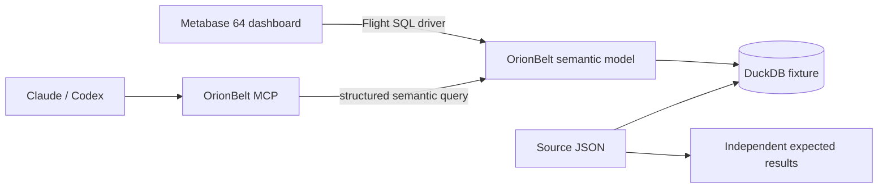

# One definition, two interfaces

An end-to-end commerce demo: Metabase uses this repository's Flight SQL driver
to query OrionBelt, while Claude or Codex queries the same semantic model through
the upstream OrionBelt MCP server. DuckDB holds a small, inspectable fixture.

The acceptance criterion is stronger than agreement between clients: every
result must also match independent Python calculations over the source JSON.
The fixture deliberately has multiple items and refunds per order. A naive
join inflates revenue; the semantic model must preserve each measure's grain.



This connection is read-only. Transformations and uploads belong on a separate
connection to a writable engine. Metric definitions live in `commerce.yaml`;
dashboard SQL and AI tools select business names without reproducing formulas.

## Run it

Prerequisites: Python 3.11+, Podman with a running machine, `podman-compose`,
and enough memory for Metabase plus the two OrionBelt services. The first driver
build downloads Maven dependencies. Run from the **repository root**:

```sh
python -m pip install requests podman-compose
python demos/orionbelt/run.py up
```

The command builds the current driver, seeds DuckDB, starts the isolated stack,
creates the connection and nine-card dashboard, and verifies every query path.
It fails on unavailable services or incorrect results; it has no skipped cases.
After a successful build, `up --skip-build` reuses the jar. Re-running `up` reloads
the model and services, reuses the fixture and updates the existing demo content.

| Surface | Address |
|---|---|
| Metabase | http://127.0.0.1:3002 |
| OrionBelt REST | http://127.0.0.1:18080 |
| OrionBelt Flight SQL | `127.0.0.1:18815` on the host; `orionbelt:8815` inside compose |
| OrionBelt MCP | http://127.0.0.1:19000/mcp |

Sign into Metabase with `admin@metabase.local` / `Metabase123!`. Open the
**OrionBelt | Shared semantics** collection and **One definition, two interfaces**.
The setup prints its URL; IDs vary between application databases.


Follow the [screenshot tutorial](../../docs/tutorials/orionbelt-shared-semantics.md)
for the business scenarios and [AI walkthrough](AI-WALKTHROUGH.md) for Claude,
Codex and MCP prompts. The two client configuration files are merge examples;
do not replace an existing client configuration with them.

```sh
python demos/orionbelt/run.py verify
python demos/orionbelt/run.py stop
```

Stop preserves the `flightsql-orionbelt` volumes and local credentials. This stack
uses separate ports, containers and volumes from the repository's other demos.
It restarts only its own services. No warehouse account or LLM API key is needed.
Metabase's paid Metabot service is not required: use your own Claude/Codex client
with OrionBelt MCP, or the deterministic MCP verifier.

## What the model demonstrates

Eight orders, thirteen items and six refund events make a small dataset that a
reader can inspect completely. Orders, items and refund events are independent
facts connected to the shared **Order Context** dimension. This topology makes
multi-fact queries use OrionBelt's Composite Fact Layer rather than selecting a
refund-only base that excludes orders with no refunds.

The seed creates two SQL views, without changing the raw fixture:

- `order_context` exposes shared order attributes without measures.
- `covered_refunds` left-joins raw refunds onto orders. Missing events have NULL
  amounts; the governed Refunds metric explicitly turns an absent sum into zero.
  Thus asking for Refunds alone still includes West, which has no refund events.

These are data preparation steps, not duplicated metric formulas. Business
definitions live in [commerce.yaml](commerce.yaml): amounts in EUR, refunds
attributed to the original order date, inclusive date bounds, distinct customers
at the requested grain, and ratios of totals. No timezone conversion is needed
for this fixture's date-only fields.

| Whole fixture | Expected |
|---|---:|
| Revenue | EUR 850.00 |
| Refunds | EUR 175.00 |
| Net Revenue | EUR 675.00 |
| Orders / customers / units | 8 / 6 / 17 |
| Average order value | EUR 106.2500 |
| Refund rate | 0.205882 (20.59% on the dashboard) |
| Deliberately wrong raw join revenue | EUR 2,150.00 |

## Evidence, not just agreement

`verify` compares independent Decimal calculations over [fixture.json](fixture.json)
with three real paths: Metabase SQL through Flight, OrionBelt's upstream MCP
`execute_query`, and Metabase 64's native MCP `execute_sql`.

- Ten scenarios cover totals, region/month breakdowns, combined filters, inclusive
  boundaries, a region with no refunds and an empty grouped result.
- Each runs with all eight metrics and with each metric alone: **90 query shapes,
  270 path comparisons**. A card cannot pass merely because selecting an unrelated
  measure happens to make the planner choose a correct plan.
- **45 saved-card checks** execute the nine cards with the dashboard's actual
  parameter mappings across five filter scenarios.
- Tool discovery, model description, Net Revenue explanation and lineage run
  against the real MCP server. Unit tests reject wrong values, dropped/duplicated
  rows, truncated responses and unexpected column names.
- Counts compare exactly; currency compares at two decimal places, AOV at four,
  and refund rate at six. The REST API can return more precision than Flight.

Evidence goes to `.logs/orionbelt/verification.json`, including model/fixture
hashes, query objects, SQL, compiled SQL, planners, expected and actual values.
`metadata.json` and `mcp-model.json` show discovery. The API key remains in the
ignored `api-key` file and is excluded from CI artifacts. A new run invalidates
old success before making any network requests and writes partial failure evidence.

**Known limitation:** the pinned Arrow JDBC 19 path duplicates column headers on
zero-row results. The verifier accepts only that exact metadata pattern when the
row set is empty, records `passed_with_known_limitations`, and does not relax
nonempty comparisons. Empty-row correctness passes; empty-result metadata parity
does not. See [compatibility details](COMPATIBILITY.md).

CI runs the demo, regression checks and repeat provisioning. Local runtime is
Podman; only GitHub Actions uses Docker. The automation verifies tool execution,
not an LLM's interpretation of unrestricted natural-language questions.

## Compatibility and boundaries

Versions: Metabase **0.64.2.9**, Arrow JDBC **19.0.0**, OrionBelt / MCP images
**2.34.0**, with OrionBelt image digests pinned in compose. The Flight container
loads a small, tested [compatibility wrapper](flight_compat.py) for numeric
connection probes, SQL catalog discovery and result-column ordering.
**This is not a claim that unmodified OrionBelt 2.34.0 works with Metabase.**
The generic Metabase driver is unchanged. Read [COMPATIBILITY.md](COMPATIBILITY.md)
before changing these pins.

This tutorial uses native SQL questions and dashboard parameters. It does not
claim arbitrary notebook aggregations, transforms, uploads, Actions, production
authorization, provider-specific AI reasoning, or scale/performance validation.
The seed performs the source preparation; the semantic connection stays read-only.
An H2 app database and demo credentials suit a local walkthrough, not a deployment.
All published services bind to loopback; the example disables OrionBelt auth.

OrionBelt 2.34.0 is source-available under BUSL-1.1; its MCP server is Apache-2.0.
See the [semantic layer](https://github.com/ralforion/orionbelt-semantic-layer)
and [MCP server](https://github.com/ralforion/orionbelt-semantic-layer-mcp).
