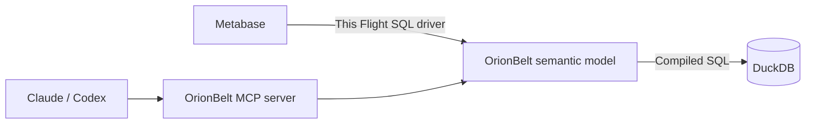

# Backend reference: OrionBelt

[OrionBelt](https://github.com/ralforion/orionbelt-semantic-layer) is a
self-hosted, source-available **semantic layer for BI tools and AI agents**.
It sits between those clients and a SQL database. A YAML model defines business
dimensions (such as Region), measures (such as Revenue), derived metrics
(such as Net Revenue), and the underlying tables, columns and joins. OrionBelt
resolves queries against that model and compiles them into SQL for the database
to execute.

OrionBelt exposes the model through Arrow Flight SQL, PostgreSQL wire and REST;
its companion MCP server lets AI clients discover definitions, inspect lineage
and execute structured semantic queries. This demo uses **DuckDB** for data
storage and execution, **OrionBelt** for shared business definitions, and
**this driver** to connect Metabase to OrionBelt's Flight SQL endpoint.



## Why use it with Metabase?

Use OrionBelt when dashboards and AI answers need to share metric definitions
maintained outside either client. For example, a Metabase native SQL question
can ask for net revenue by region using business names:

```sql
SELECT "Region", "Net Revenue" FROM commerce ORDER BY "Region"
```

Here `commerce` is the semantic model. The Net Revenue formula, refund handling
and join relationships live in [commerce.yaml](../../demos/orionbelt/commerce.yaml).
An AI client selects the same dimension and metric through MCP, without having
to reconstruct the formula or physical joins. The model can be versioned and
reviewed in Git; MCP explanations and lineage help users inspect its meaning.

The driver makes this shared model available to Metabase. Correct results also
depend on the model: the demo compares both query paths with independent
calculations over the source fixture, including cases where joins could inflate
totals or omit orders without refunds.

## Deploy

The [complete demo](../../demos/orionbelt/README.md) runs OrionBelt 2.34.0 over
DuckDB with Metabase 0.64.2.9 and the upstream OrionBelt MCP server. Follow the
[screenshot tutorial](../tutorials/orionbelt-shared-semantics.md) for setup,
shared metric definitions, dashboard filters and Claude/Codex exercises.

```sh
python demos/orionbelt/run.py up
```

## Connection

Metabase runs at http://127.0.0.1:3002. Its Arrow Flight SQL connection uses
host `orionbelt`, port `8815`, no encryption or authentication, and disables
uploads and Actions. All published ports bind to loopback. Host clients use
Flight port `18815`; MCP is `http://127.0.0.1:19000/mcp`.

## Feature support

| Capability | Tested scope |
|---|---|
| Schema discovery | The commerce model's fields plus semantic metadata tables |
| Native semantic SQL | Dimensions and named measures/metrics, grouped and filtered |
| Dashboards | Nine saved cards, text/date parameters, five filter scenarios |
| OrionBelt MCP | Discovery, description, metric explanation, lineage, structured query execution |
| Metabase MCP | Native `execute_sql` against the Flight connection |
| Transforms / uploads / Actions | Disabled; this demo's semantic connection is read-only |
| Arbitrary notebook queries, other warehouses, production auth or load | Not established by this demo |

## Gotchas

**Compatibility adapters are required for the pinned Flight image.** They fix
numeric connection probes, SQL catalog projections and result-column ordering
inside the OrionBelt container; the generic driver is unchanged. Empty results
still expose duplicated JDBC column headers, recorded separately from verified
row parity. See [compatibility notes](../../demos/orionbelt/COMPATIBILITY.md)
before upgrading or generalizing the result.
