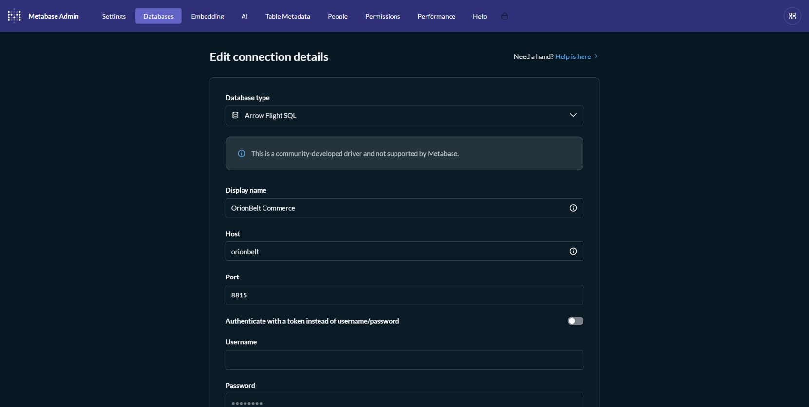
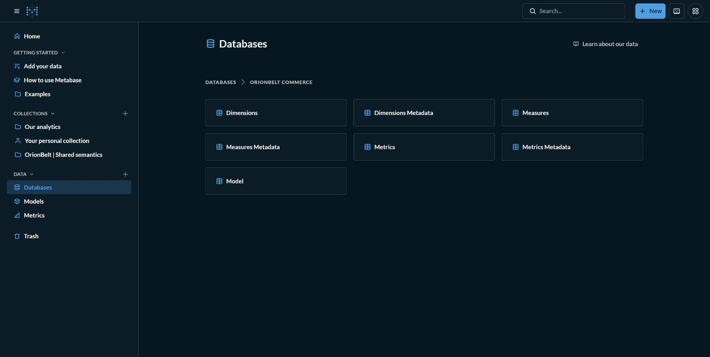
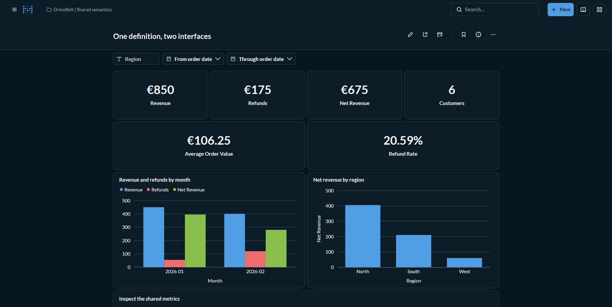
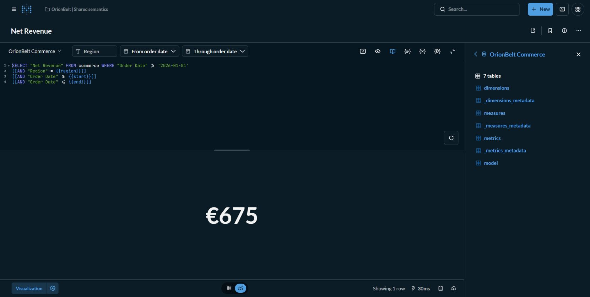
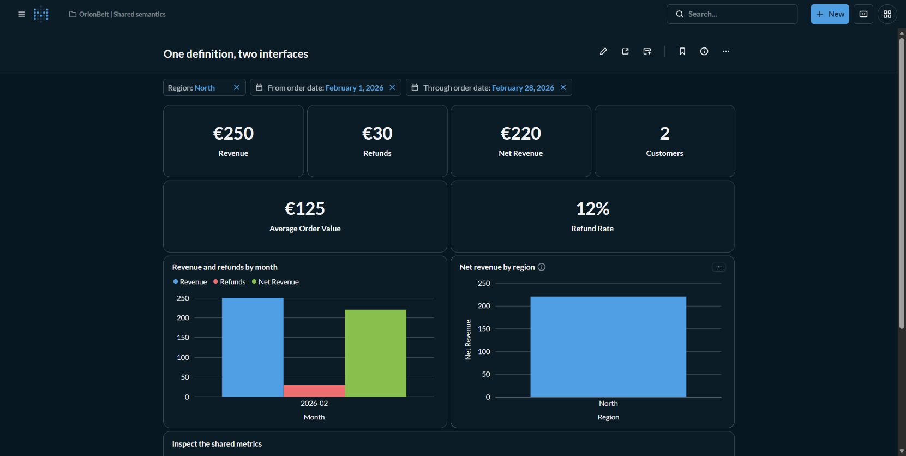
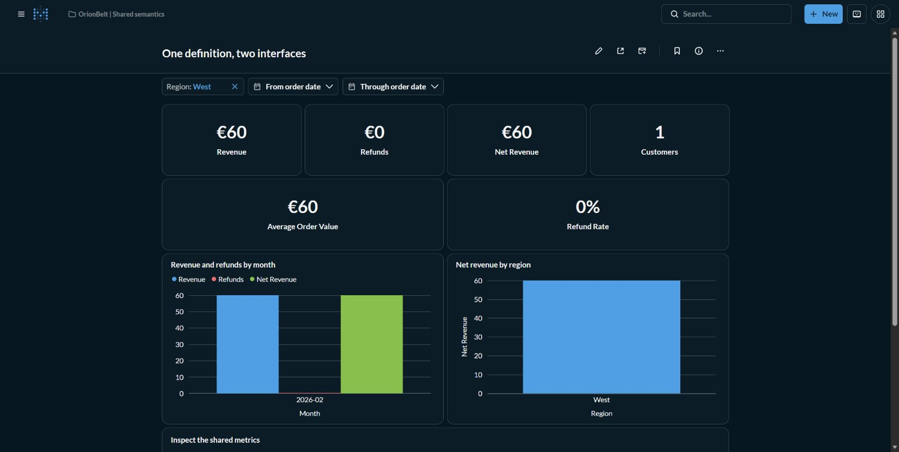

# Tutorial: the same governed answer in Metabase and AI

**Backend:** OrionBelt 2.34.0 over DuckDB · **Metabase:** 0.64.2.9
**Level:** intermediate · **Walkthrough:** about 20 minutes after the first build

## Problem

A dashboard says net revenue is 675. An AI assistant says 385. Is the difference
a filter, a join, a missing refund, or a different definition of revenue?
Even when both say 385, agreement does not prove correctness.

This demo puts business definitions in an OrionBelt semantic model, exposes
them to Metabase through Flight SQL and to Claude/Codex through MCP, and checks
both against independent calculations over a small source fixture. The same
checks caught the 385-versus-675 modeling error while building this tutorial.

## When this is useful

| Use case | What to try | What the demo establishes |
|---|---|---|
| Finance and management reporting | Revenue, refunds and net revenue scorecards | One reviewed definition is reused by dashboards and agent tools |
| Regional operating reviews | Filter to North and February | Both interfaces apply the same dimensions and inclusive date bounds |
| Customer reporting | Compare monthly and overall distinct customers | Four plus four monthly customers does not mean eight unique customers |
| Refund monitoring | Select West; compare South's February refund rate | Missing events mean zero, while a fully refunded cohort can have a 100% rate |
| Analyst self-service | Open a card's SQL | Queries select business names; the client does not repeat join or ratio formulas |
| Explainable AI answers | Ask for Net Revenue's explanation and lineage before execution | The tool exposes the metric's dependencies and compiled query |
| Regression review | Run the verifier after changing the model or engine | Shared mistakes, projection-dependent results and column-order errors are detected |

This is a controlled semantic-consistency exercise. The fixture is synthetic,
small and local; it does not benchmark a warehouse or evaluate unrestricted LLM
reasoning. Customer names are synthetic. Currency is EUR throughout.

## 1. Start the isolated demo

Use a running Podman machine, Python 3.11+ and `podman-compose`. From this repo:

```sh
python -m pip install requests podman-compose
python demos/orionbelt/run.py up
```

The first run builds the driver, seeds the fixture and starts Metabase plus the
upstream OrionBelt Flight and MCP services. Setup creates a read-only connection,
nine saved questions and a filterable dashboard, then runs the acceptance checks.
Later, `up --skip-build` reuses the built jar and updates the same demo content.

Open http://127.0.0.1:3002 and sign in with `admin@metabase.local` /
`Metabase123!`. The setup prints the dashboard URL. You can also find it in
**OrionBelt | Shared semantics → One definition, two interfaces**.

The normal port-3000 demo is not needed. This stack uses its own loopback ports,
named volumes and application database. See the
[demo README](../../demos/orionbelt/README.md) for lifecycle commands and ports.

## 2. Inspect the connection and semantic catalog

Under **Admin → Databases → OrionBelt Commerce**, the driver is Arrow Flight SQL,
host `orionbelt`, port `8815`. These are the service address and internal port;
the host's Flight port is `18815`. The fixture's isolated service has no auth or
TLS; uploads and Actions are disabled.



Browse **Databases → OrionBelt Commerce**. Its `commerce` namespace exposes
the semantic `model` plus dimension, measure and metric metadata tables. Raw
warehouse joins are not something each dashboard or assistant needs to recreate.



The authoritative definitions are in
[commerce.yaml](../../demos/orionbelt/commerce.yaml). Revenue sums order amounts;
Refunds converts missing refund sums to zero; Net Revenue subtracts Refunds;
Average Order Value divides revenue by distinct orders; Refund Rate divides
refunds by revenue. Distinct customer counts are recomputed at each requested grain.

The source has three facts: orders, items and refund events. Each points to
shared Order Context attributes. A source view preserves orders without refund
events. This makes the model's fact coverage explicit and keeps a metric stable
whether it is queried alone or with seven other metrics.

## 3. Read the financial overview

With no filters, the dashboard shows:



| Metric | Expected |
|---|---:|
| Revenue | EUR 850 |
| Refunds | EUR 175 |
| Net Revenue | EUR 675 |
| Customers | 6 |
| Average Order Value | EUR 106.25 |
| Refund Rate | 20.59% displayed; 0.205882 at model precision |

The monthly chart shows net revenue falling from 395 to 280. The regional
chart shows North 405, South 210 and West 60. These are descriptions of this
fixture, not statistically meaningful trends from eight orders.

Open **Net Revenue → Open editor**. The saved question selects the governed
metric and adds optional filters. It contains neither a raw join nor a locally
invented `SUM(revenue) - SUM(refunds)` expression:



```sql
SELECT "Net Revenue" FROM commerce
WHERE "Order Date" >= '2026-01-01'
[[AND "Region" = {{region}}]]
[[AND "Order Date" >= {{start}}]]
[[AND "Order Date" <= {{end}}]]
```

The fixed lower bound covers the fixture's reporting period. Optional values
use Metabase's template parameters. Card queries use native SQL; this tutorial
does not establish arbitrary notebook aggregation support on semantic tables.

## 4. Run a regional review with the same filters in AI

On the dashboard, type **North** into Region and press Enter. Set **From order
date** to February 1, 2026 and **Through order date** to February 28, 2026.



The expected answer is revenue **250**, refunds **30**, net revenue **220**,
**2** customers, AOV **125**, refund rate **12%**. Both date endpoints are included.

Merge [the Claude example](../../demos/orionbelt/claude.mcp.json) or
[the Codex example](../../demos/orionbelt/codex.config.toml) into your client's
configuration, keeping existing servers. Both use
`http://127.0.0.1:19000/mcp`; the client must be able to reach your computer.
This uses OrionBelt MCP directly, so no paid Metabot service is needed.

Use the full [AI exercise instructions](../../demos/orionbelt/AI-WALKTHROUGH.md),
then ask:

> Using the commerce semantic model, show North's revenue, refunds and net
> revenue for February 1 through February 28, 2026. State the currency and date
> attribution. Show the query object and explain the Net Revenue definition.

The real upstream MCP tool is `execute_query`. Its `query_json` argument is a
JSON string containing this object; use `format_values: false` when comparing:

```json
{
  "select": {
    "dimensions": [],
    "measures": ["Revenue", "Refunds", "Net Revenue"]
  },
  "where": [
    {"field": "Region", "op": "equals", "value": "North"},
    {"field": "Order Date", "op": "gte", "value": "2026-02-01"},
    {"field": "Order Date", "op": "lte", "value": "2026-02-28"}
  ]
}
```

Compare by column **name**, not position: REST can return base measures before
derived metrics. The automated verifier also checks the third path, Metabase's
own `/api/metabase-mcp` endpoint, through `execute_sql`.

## 5. Test the cases that usually cause disagreement

**Distinct customers.** Ask for Customer Count by Month and then overall.
January has four and February has four; Alice and Cara appear in both months,
so overall is six. Never sum the grouped counts to manufacture the overall KPI.

**Ratios of totals.** Overall AOV is `850 / 8 = 106.25`. An unweighted average
of the three regional AOVs is a different calculation. Ask the agent to explain
the governed metric before attempting its own arithmetic.

**No refunds.** Clear the dates and set Region to **West**. Revenue and net revenue
are 60; refunds and refund rate are zero. The refund source view and COALESCE
definition preserve this case even when Refunds is the only selected metric.



**Inclusive dates.** Clear Region and use January 31 through February 1.
Revenue is 200, refunds 30 and net revenue 170. This catches off-by-one date filters.

**No matching group.** Ask for a Region breakdown filtered to `Missing`.
The expected grouped row set is empty. This is different from a zero-valued
existing region and from an aggregate query with no grouping.

**Date attribution.** Ask "How much cash was refunded during February?"
The correct response identifies a limitation: this model attributes refunds to
the original order date and has no refund-payment date. A confident invented
cash-flow answer is a failure even if its arithmetic matches a dashboard.

## 6. Explain and audit an answer

Discover the MCP tools and call:

```text
describe_model({})
explain_artefact({"name": "Net Revenue"})
get_lineage({"name": "Net Revenue", "output_format": "json"})
```

Net Revenue's dependencies must include Revenue and Refund Amount. The latter
comes from the refund source; Revenue comes from orders. `execute_query`
returns compiled SQL and planner information, so the agent can show how the
business query was executed. The verifier stores actual explanation and lineage
responses under `semantic_discovery` in its evidence file.

These are tool-call examples, not a screenshot or transcript of an LLM run.
The deterministic checks execute the real MCP services without an LLM API key.
Use the client walkthrough to assess a particular model's interpretation too.

## 7. Establish confidence independently

```sh
python demos/orionbelt/run.py verify
```

The fixture deliberately yields **2,150** if raw orders, items and refunds are
naively joined before summing revenue. The correct revenue is **850**.
[The oracle](../../demos/orionbelt/oracle.py) calculates results directly from
JSON using Decimal arithmetic; it does not ask OrionBelt to check itself.

Acceptance covers **270 path comparisons** (ten scenarios, all eight metrics
together plus each alone, across three interfaces) and **45 saved-card/filter
checks**. It also exercises discovery and lineage. There are no service-dependent
skips. Every unavailable service or unexpected value fails the run.

Inspect `.logs/orionbelt/verification.json`: it contains model and fixture hashes,
expected and actual rows, SQL, QueryObjects, compiled SQL and known limitations.
A new run overwrites stale success before connecting and records partial failures.
The CI artifact retains this evidence without the local API key.

There is one explicit metadata exception: Arrow JDBC 19 duplicates headers on
empty results. The verifier checks that exact pattern and zero rows, then records
`passed_with_known_limitations`. Nonempty column mismatches still fail. Details,
including the three demo-local Flight adapters, are in
[COMPATIBILITY.md](../../demos/orionbelt/COMPATIBILITY.md).

## Variations and boundaries

- **Review a metric change:** edit a formula in the model and rerun `up --skip-build`.
  A changed answer should fail the unchanged acceptance oracle. Review the business
  definition and expected values separately before approving a new baseline.
- **Extend the fixture:** add cancellations, taxes, currencies or refund dates,
  then define their semantics and new independent expected results. The seed
  refuses to overwrite a different fixture in an existing database; use a new
  isolated database/volume deliberately. Those scenarios are not implemented here.
- **Warehouse preparation:** the seed's views show where source shaping belongs.
  To demonstrate Metabase transforms, use a separate writable engine connection
  and publish its prepared tables through OrionBelt. This read-only semantic
  connection does not claim transform, upload or Actions support.
- **Production access:** test permissions, authentication, tenant boundaries,
  freshness and audit policies separately. This loopback demo uses a local H2
  application database and synthetic data, not a production security setup.

Stop with `python demos/orionbelt/run.py stop`; it preserves the demo's volumes.
Related tutorials: [federation](federation-semantic-layer.md),
[transformations](transformations-in-metabase.md) and
[verifiable time-travel BI](verifiable-timetravel-bi.md).
